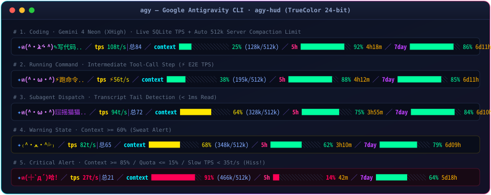

<div align="center">

# ✦ agy-hud

**Zero-Dependency Cyberpunk TrueColor HUD for Google Antigravity CLI (`agy`)**

*Live SQLite Nanosecond TPS · Auto-Tracking Server Compaction Thresholds · Quota Bars · Reactive Cyber-Cat Mascot*

[](./package.json)
[-4E95FF?style=flat-square&labelColor=0f1528)](https://nodejs.org/)
[](#quick-install)
[](./LICENSE)

**English** | [简体中文](./README_CN.md)

<br />



</div>

---

## Why `agy-hud`?

Most status lines for `agy` only format the raw JSON piped by the CLI — which reports the physical `1.0M` context window (not when server-side auto-compaction actually fires) and exposes **no token speed (TPS)** telemetry.

`agy-hud` stays a **single zero-dependency `.mjs` file** while decoding the active session's local SQLite Protobuf records directly in pure JavaScript:

| Capability | Typical Statusline | **`agy-hud`** |
| :--- | :---: | :---: |
| **Zero external dependencies** (no `npm install`, no build step) | Rare | **Yes (1 file)** |
| **Pure Decode TPS vs. Total Thinking TPS** (`108t/s\|总84`) | No | **Yes (nanosecond SQLite)** |
| **Live Server Compaction Threshold** (`CheckpointConfig.max_token_limit`) | Hardcoded / 1M raw | **Auto-decoded live + 512k/840k/256k fallback** |
| **Mid-Session `/model` Switch Guard** | — | **Yes (model-family match)** |
| **Live Tool & Action Detection** (`< 1ms` transcript tail read) | Basic state only | **11 reactive cyber-cat states** |
| **CJK / Emoji Width-Aware Narrow Terminal Collapse** | Often wraps | **Yes (`terminal_width` adaptive)** |

---

## Quick Install

### Windows (PowerShell)

```powershell
irm https://raw.githubusercontent.com/liuqiaodongdong/agy-hud/main/scripts/install.ps1 | iex
```

### macOS / Linux

```bash
bash <(curl -fsSL https://raw.githubusercontent.com/liuqiaodongdong/agy-hud/main/scripts/install.sh)
```

> **What the installer does:**
> 1. Places `agy-hud.mjs` into `~/.gemini/antigravity-cli/agy-hud.mjs`.
> 2. Safely merges only the `statusLine` block into `~/.gemini/antigravity-cli/settings.json` (preserving all existing settings).
>
> **Node.js requirement:** Works on **Node >= 18**. Running **Node >= 22.5** automatically unlocks built-in `node:sqlite` for live TPS telemetry and live server compaction threshold decoding (zero native addons needed).

### Manual Install

1. Copy [`agy-hud.mjs`](./agy-hud.mjs) to `~/.gemini/antigravity-cli/agy-hud.mjs`.
2. Merge [`settings.example.json`](./settings.example.json) into `~/.gemini/antigravity-cli/settings.json`:

```json
{
  "statusLine": {
    "type": "command",
    "command": "node /absolute/path/to/.gemini/antigravity-cli/agy-hud.mjs",
    "stack_with_default": true
  }
}
```

### Uninstall

```powershell
# Windows (PowerShell)
& ([scriptblock]::Create((irm https://raw.githubusercontent.com/liuqiaodongdong/agy-hud/main/scripts/install.ps1))) -Uninstall
```

```bash
# macOS / Linux
bash <(curl -fsSL https://raw.githubusercontent.com/liuqiaodongdong/agy-hud/main/scripts/install.sh) --uninstall
```

---

## Feature Breakdown

### 1. Live Nanosecond TPS Meter (`tps`)
Opens only the **current session's** `~/.gemini/antigravity-cli/conversations/<conversation_id>.db` in read-only mode (once per render) and decodes `gen_metadata` + `steps` using a built-in zero-dependency Protobuf reader:
* **Final text reply**: shows **pure decode speed** + **end-to-end thinking-inclusive speed** (e.g., `tps 108t/s|总84`). On narrow terminals, gracefully collapses to `tps 108t/s`.
* **Intermediate tool-call step**: shows step end-to-end TPS with a lightning indicator (`tps ⚡56t/s`).
* **Color thresholds**: `>= 65 t/s` mint green · `35–64 t/s` cyber yellow · `< 35 t/s` laser red.

### 2. Real Server Compaction Limit (`context`)
Instead of misleadingly showing `12% (128k/1.0M)` while Antigravity is actually about to auto-compact your history:
1. **Primary source (Live)**: Decodes `executor_metadata` → `cascade_config.checkpoint_config.max_token_limit` directly from the active conversation DB. Whenever Google changes compaction thresholds server-side, `agy-hud` tracks it automatically on the next turn.
2. **Model-switch safety**: Verifies `planner_config.model_name` against the active model family so switching via `/model` (e.g., Gemini 4 → Claude 5.5) never applies stale limits from the previous turn.
3. **Smart fallbacks** (turn 0 before `executor_metadata` exists, or Node < 22.5):
   * **Gemini 4** (Neon / Carbon / Argon / Hydrogen) & **Orchestrator (Neon / Carbon / Argon)** → `512k`
   * **Gemini 3.8 Flash** → `256k`
   * **Claude Opus / Sonnet 5.5** → `840k` (always clamped to physical `context_window_size`, e.g. `200k`)

### 3. Reactive Cyber-Cat Mascot (哈基米星芒猫娘)
Reads at most the **last 32 KB** of the active session's `transcript.jsonl` (`< 1ms`) to reflect live agent activity and health:

| State | Mascot | Trigger |
| :--- | :--- | :--- |
| **Thinking** | `✦₍^•-•^₎💭思考..` | Active planner reasoning |
| **Reading** | `✦ฅ(•̀ω•́🔎)翻文件..` | `read_file`, `grep_search`, `list_dir`, etc. |
| **Coding** | `✦ฅ(^•̀ﻌ•́^)✎写代码..` | `edit_file`, `write_file`, etc. |
| **Command** | `✦ฅ(^•ω•^)⚡跑命令..` | `run_command`, `manage_task`, etc. |
| **Web** | `✦ฅ(^⊙ω⊙^)🌐冲浪..` | `search_web`, `read_url_content` |
| **Subagent** | `✦ฅ(^•ω•^)🐾摇猫猫..` | `invoke_subagent`, `send_message`, etc. |
| **Waiting** | `✦ฅ(^•ω•^?)等你喵` | Waiting for user input / approval |
| **Proud** | `✦ฅ(^•̀ﻌ•́^)✧` | Idle right after editing code |
| **Idle** | `✦ฅ(^•ω•^ฅ)` | Normal ready state |
| **Sweat** | `✦₍^•ﻌ•^💦₎` | Context `>= 60%` or quota `<= 35%` |
| **Hiss!** | `✦ฅ(╬\`д´)哈!` | Context `>= 85%` or quota `<= 15%` |

### 4. Gemini Quota Bars (`5h` & `7day`)
Displays remaining fraction bars (`8`-block continuous TrueColor bars), percentage, and reset countdown (`4h18m`, `6d11h`), automatically filtering out disabled/third-party buckets to keep the bar crisp and uncluttered.

---

## Local Preview & Testing

Clone the repository and run the built-in test & visual preview suite:

```bash
git clone https://github.com/liuqiaodongdong/agy-hud.git
cd agy-hud

# Run all automated assertions
npm test

# Print live TrueColor terminal preview of all states
npm run preview
```

---

## License

[MIT](./LICENSE) © 2026 Laidh (`liuqiaodongdong`)
