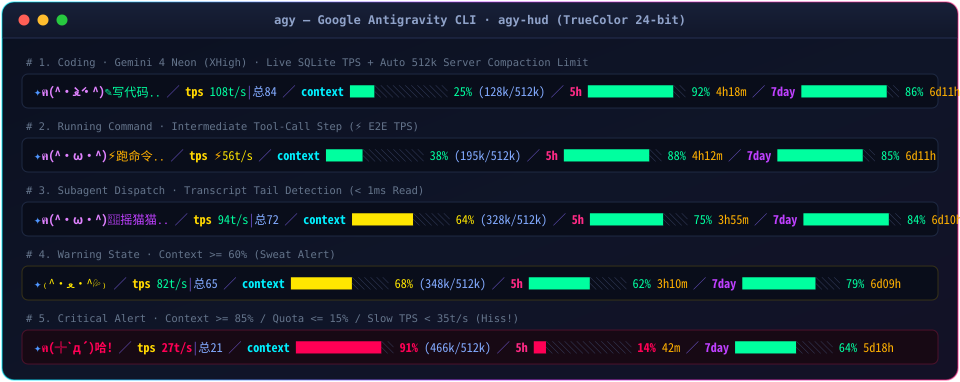

<div align="center">

# ✦ agy-hud

**零依赖赛博朋克 TrueColor 状态栏 HUD — 专为 Google Antigravity CLI (`agy`) 打造**

*本地 SQLite 纳秒级 TPS 测速 · 服务端真实压缩阈值自动追踪 · 配额倒计时 · 哈基米星芒猫娘动态变脸*

[](./package.json)
[-4E95FF?style=flat-square&labelColor=0f1528)](https://nodejs.org/)
[](#一键安装)
[](./LICENSE)

[English](./README.md) | **简体中文**

<br />



</div>

---

## 为什么选 `agy-hud`？

普通的 `agy` 状态栏脚本只能被动展示 CLI 管道传过来的 JSON——那里面的 `context_window_size` 永远是物理上限 `1.0M`（而不是服务端真正触发自动压缩的阈值），而且**完全没有吐字速度（TPS）数据**。

`agy-hud` 在保持**单文件、零第三方依赖**的前提下，纯手写轻量 Protobuf 解码器直读当前会话 SQLite 遥测库：

| 核心特性 | 普通状态栏 | **`agy-hud`** |
| :--- | :---: | :---: |
| **零外部依赖**（免 `npm install`、免编译构建） | 少见 | **单文件即用** |
| **纯吐字 TPS + 含思考综合 TPS**（`108t/s\|总84`） | 无 | **直读本地 SQLite 纳秒级遥测** |
| **服务端真实压缩阈值**（`CheckpointConfig.max_token_limit`） | 写死旧值 / 显示 1M 虚高上限 | **实时动态解码 + 512k/840k/256k 兜底** |
| **中途 `/model` 切模型防串台保护** | — | **按模型系列自动校验** |
| **实时工具动作感知**（`< 1ms` 仅读尾部 32KB） | 仅粗略状态 | **11 种哈基米猫娘动态颜文字** |
| **中日韩宽字符 + 窄终端自适应折叠** | 容易换行崩坏 | **按 `terminal_width` 自动收起次要段** |

---

## 一键安装

### Windows（PowerShell）

```powershell
irm https://raw.githubusercontent.com/liuqiaodongdong/agy-hud/main/scripts/install.ps1 | iex
```

### macOS / Linux

```bash
bash <(curl -fsSL https://raw.githubusercontent.com/liuqiaodongdong/agy-hud/main/scripts/install.sh)
```

> **安装脚本会做两件事：**
> 1. 将 `agy-hud.mjs` 安装至 `~/.gemini/antigravity-cli/agy-hud.mjs`。
> 2. 安全合并 `~/.gemini/antigravity-cli/settings.json` 中的 `statusLine` 字段（不会覆盖你的其他配置）。
>
> **Node.js 版本说明**：支持 **Node >= 18**；推荐使用 **Node >= 22.5**，自动启用内置 `node:sqlite` 解锁实时 TPS 测速与动态压缩阈值（无需任何 C++ 原生编译依赖）。

### 手动安装

1. 将 [`agy-hud.mjs`](./agy-hud.mjs) 复制到 `~/.gemini/antigravity-cli/agy-hud.mjs`。
2. 在 `~/.gemini/antigravity-cli/settings.json` 中合并 [`settings.example.json`](./settings.example.json)：

```json
{
  "statusLine": {
    "type": "command",
    "command": "node C:/Users/<用户名>/.gemini/antigravity-cli/agy-hud.mjs",
    "stack_with_default": true
  }
}
```

### 一键卸载

```powershell
# Windows (PowerShell)
& ([scriptblock]::Create((irm https://raw.githubusercontent.com/liuqiaodongdong/agy-hud/main/scripts/install.ps1))) -Uninstall
```

```bash
# macOS / Linux
bash <(curl -fsSL https://raw.githubusercontent.com/liuqiaodongdong/agy-hud/main/scripts/install.sh) --uninstall
```

---

## 核心功能详解

### 1. 纳秒级实时 TPS 测速（`tps`）
每次刷新只以只读方式打开**当前活跃会话**的 `~/.gemini/antigravity-cli/conversations/<conversation_id>.db` 一次，零跨库扫描开销，直接解码 `gen_metadata` 与 `steps`：
* **正文回复完成**：同时展示**纯正文吐字 TPS** 与 **含思考全流程综合 TPS**（如 `tps 108t/s|总84`），一眼分清“模型本身快不快”还是“思考花了太久”；终端较窄时自动折叠为 `tps 108t/s`。
* **工具调用中间步**：以闪电图标显示当前步骤综合 TPS（`tps ⚡56t/s`）。
* **分档霓虹配色**：`>= 65 t/s` 荧光薄荷绿 · `35–64 t/s` 赛博黄 · `< 35 t/s` 激光红。

### 2. 服务端真实压缩阈值自动追踪（`context`）
告别“界面显示 12% (128k/1.0M)，下一秒突然触发自动压缩”的错觉：
1. **实时动态读取（主数据源）**：直接解码当前会话 DB 中最新一条 `executor_metadata` 里的 `cascade_config.checkpoint_config.max_token_limit`。以后 Google 再次调整任何模型的压缩上限（如 256k → 512k → 1M），HUD 会自动同步，无需手动改代码。
2. **切模型防串台**：同步比对 `planner_config.model_name` 与当前活跃模型系列，刚用 `/model` 切换模型（如 Gemini 4 → Claude 5.5）不会误套上一轮旧模型的阈值。
3. **首轮 / 兼容兜底**：
   * **Gemini 4 全系**（Neon / Carbon / Argon / Hydrogen）及 **Orchestrator (Neon / Carbon / Argon)** → `512k`
   * **Gemini 3.8 Flash** → `256k`
   * **Claude Opus / Sonnet 5.5** → `840k`（自动受物理上下文上限如 `200k` 约束）

### 3. 哈基米星芒猫娘动态颜文字（11 种实时状态）
只读取当前会话 `transcript.jsonl` 尾部最多 **32 KB**（`< 1ms`），根据实时工具调用、上下文水位与配额余量自动变脸：

| 状态 | 颜文字 | 触发条件 |
| :--- | :--- | :--- |
| **思考中** | `✦₍^•-•^₎💭思考..` | 模型推理思考中 |
| **翻文件** | `✦ฅ(•̀ω•́🔎)翻文件..` | `read_file`、`grep_search`、`list_dir` 等 |
| **写代码** | `✦ฅ(^•̀ﻌ•́^)✎写代码..` | `edit_file`、`write_file` 等 |
| **跑命令** | `✦ฅ(^•ω•^)⚡跑命令..` | `run_command`、`manage_task` 等 |
| **冲浪中** | `✦ฅ(^⊙ω⊙^)🌐冲浪..` | `search_web`、`read_url_content` |
| **摇猫猫** | `✦ฅ(^•ω•^)🐾摇猫猫..` | 派发/通信 Subagent（`invoke_subagent` 等） |
| **等你喵** | `✦ฅ(^•ω•^?)等你喵` | 等待用户确认或输入 |
| **小得意** | `✦ฅ(^•̀ﻌ•́^)✧` | 刚完成代码修改并进入空闲 |
| **常规待机** | `✦ฅ(^•ω•^ฅ)` | 满血健康待机 |
| **流汗预警** | `✦₍^•ﻌ•^💦₎` | 上下文 `>= 60%` 或配额余量 `<= 35%` |
| **炸毛哈气** | `✦ฅ(╬\`д´)哈!` | 上下文 `>= 85%` 或配额余量 `<= 15%` |

### 4. Gemini 配额余量监控（`5h` / `7day`）
展示 8 格连续 TrueColor 进度条、余量百分比与重置倒计时（如 `4h18m`、`6d11h`），自动过滤非 Gemini 与禁用桶，保持状态栏紧凑利落。

---

## 本地测试与终端预览

```bash
git clone https://github.com/liuqiaodongdong/agy-hud.git
cd agy-hud

# 运行完整自动化测试集
npm test

# 在终端实时渲染 TrueColor 效果图预览
npm run preview
```

---

## 开源协议

[MIT](./LICENSE) © 2026 Laidh (`liuqiaodongdong`)
